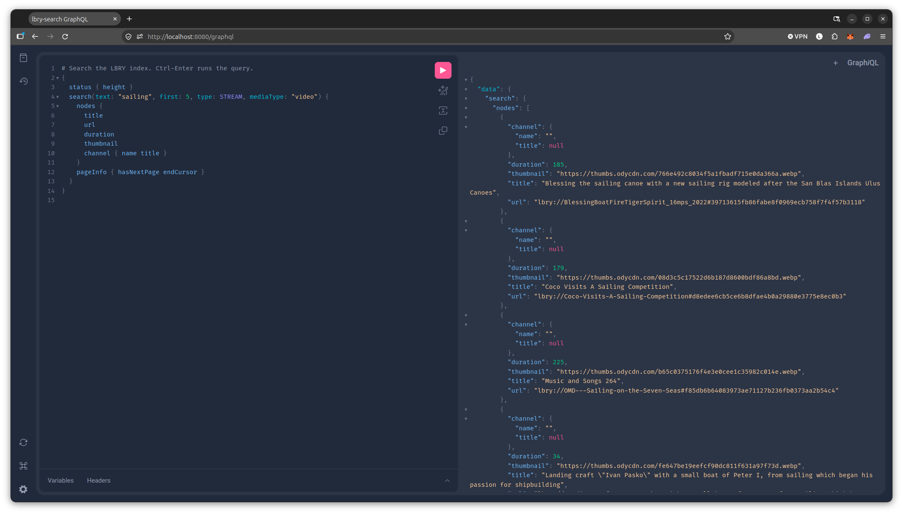

# lbry-search

Full-text search for the LBRY network: a Go indexer that follows an LBRY full node
([lbcd](https://github.com/lbryio/lbcd)) into a single SQLite file, and a small server that
answers searches from it with [Lighthouse](https://github.com/lbryio/lighthouse)'s API.
No Elasticsearch, no Chainquery, no hub.

```
lbcd (full node) ──JSON-RPC──► lbry-indexer ──► lbry-search.db (SQLite + FTS5) ◄── lbry-search (HTTP)
```

## Why

Lighthouse copies Chainquery's MySQL mirror of the chain into Elasticsearch; the hub's own
search also needs Elasticsearch. That's a lot of moving parts (and 8–16 GB of RAM) for
text search. Here the indexer reads blocks straight from lbcd, decodes claims itself, and
keeps one file that the server reads.

## What gets indexed

Every stream and channel claim, from genesis:

- **Claims:** new claims, updates and abandons (`OP_CLAIM_NAME`, `OP_UPDATE_CLAIM`, spends).
  Values in all three formats: current protobuf (signed and unsigned), the 2018–19 legacy
  protobuf, and the original JSON.
- **Metadata:** name, title, description, author, tags, languages, thumbnail, media type,
  duration, release time, fee, signing channel (and its name), reposted claim.
- **LBC staked:** the claim's own amount plus its unspent supports.
- **Reorgs:** the last 200 blocks keep an undo log; a reorg rolls back to the fork and
  re-indexes the new branch.

## Ranking

SQLite FTS5 BM25 with the hub's field weights (channel name ×8, claim name ×4, title and
author ×1, tags and description ×0.5), then:

- × `1 + log10(1 + LBC staked) / 2`
- × up to 1.5 for releases in the last few weeks
- an exact channel-name match (`@name` or `name`) comes first

## API (Lighthouse-compatible)

```
GET /search?s=sailing&size=20&from=0
            [&claimType=stream|channel] [&mediaType=video|audio]
            [&maxDuration=180] [&minDuration=181]
GET /autocomplete?s=sail          (last word as a prefix, up to 10 results)
GET /status                       ({"height": …, "hash": …})
```

Results are Lighthouse's `[{"name", "claimId"}]` plus `title`, `channel`,
`channel_claim_id`, `value_type`, `duration`, `thumbnail_url`, `effective_amount` (dewies)
and `score`. `-blocklist <url>` hides claim and channel IDs from a moderation list
(e.g. Carrel's `moderation/blocklist.json`), refreshed every 10 minutes.

## GraphQL

`POST /graphql` (or `GET /graphql?query=…`, cached for a minute). Open `/graphql` in a
browser for GraphiQL, with the schema docs and autocompletion (`-graphiql=false` turns it off).



```graphql
{
  search(text: "sailing", first: 10, type: STREAM, mediaType: "video", maxDuration: 600) {
    nodes { id title url duration thumbnail stakedDewies channel { name title } }
    pageInfo { hasNextPage endCursor }   # pass endCursor as `after` for the next page
  }
  channel(id: "…") { title claims(first: 20) { nodes { title releaseTime } } }
  claim(id: "…") { title description tags languages mediaType fee { amount currency } repostOf { url } }
  autocomplete(text: "sail") { name title }
  status { height hash }
}
```

- Same index and ranking as the REST API, and the blocklist applies everywhere: blocked
  claims and channels' claims don't appear, and `claim`/`channel` return null for them.
- Pages are up to 100 items; a channel's claims come newest first. Amounts are strings in
  dewies (1 LBC = 10^8), since they don't fit GraphQL's 32-bit `Int`.
- Limits per query: 16 KB, 10 levels deep, and 20,000 fields counting each list item
  (so `search(first: 100)` with `channel { claims(first: 100) }` under it is refused).

## Run

Needs Go 1.22+ and a C compiler (SQLite via `mattn/go-sqlite3`, built with FTS5):

```sh
make                       # go build -tags sqlite_fts5 ./cmd/...
./bin/lbry-indexer -db lbry-search.db -rpc http://127.0.0.1:9245 -rpcuser lbry -rpcpass …
./bin/lbry-search  -db lbry-search.db -addr :8080 \
  -blocklist https://raw.githubusercontent.com/bitcoinbrisbane/carrel-ios/main/moderation/blocklist.json
```

lbcd needs its RPC server on (`rpcuser`/`rpcpass`, and `notls=1` for plain HTTP on
localhost; see `deploy/lbcd.conf`). `deploy/` has systemd units for lbcd, the indexer, the server and
[lbry-daemon](https://github.com/LBRYFoundation/lbry-daemon), which can send `claim_search`
text queries here with `LBRY_SEARCH_URL`. The server opens the index read-only, so both run side by side.

**Pruned nodes.** With [bitcoinbrisbane/lbcd](https://github.com/bitcoinbrisbane/lbcd)'s
`--prune`, the indexer calls `setprunehold` as it goes (every 100 blocks and at the tip), so
the node never deletes blocks it hasn't indexed yet. Start the indexer with the node: if the
node has already pruned blocks the index still needs, it stops with a clear error. To index
what's left anyway, start an empty index at the node's `pruneheight` with `-from <height>`:
claims created below it aren't indexed, and their updates and supports are skipped.
While catching up the indexer skips undo records until it's within 200 blocks of the tip.

```sh
make test                  # go test -tags sqlite_fts5 ./...
```

## Layout

```
cmd/lbry-indexer   follow lbcd, write the index
cmd/lbry-search    HTTP server (REST and GraphQL)
internal/gql       GraphQL schema, resolvers, query limits, GraphiQL
internal/chain     LBRY blocks and transactions, claim scripts, claim IDs, RIPEMD-160
internal/claim     claim value decoding (v2 protobuf, legacy v1 protobuf, JSON)
internal/index     applying blocks; sync loop with reorg handling
internal/store     SQLite schema, FTS5, undo log, search and ranking
internal/lbcd      JSON-RPC client
```

## Not yet

- Trending (support changes over time) as a ranking signal
- Reposts adding to the original's stake
- Takeover/controlling-claim logic and short URLs (results carry permanent `name#claimId`)
- Name normalisation beyond lower-casing

## License

MIT
